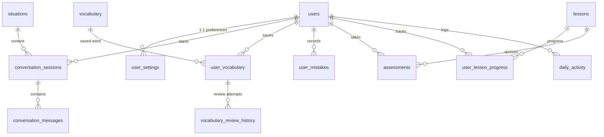

# 🌿 Kannada for Everyone (ಕನ್ನಡ ಎಲ್ಲರಿಗಾಗಿ)

> **Learn Kannada. Speak confidently. Connect locally.**
> An AI-assisted learning platform helping Marathi, Hindi, and English speakers learn practical spoken Kannada through everyday role-plays, interactive lessons, spaced-repetition vocabulary, text chat, and recorded voice practice.

---

## 1. Project Overview

**Kannada for Everyone** is designed for migrants, students, professionals, and residents in Karnataka who want to speak practical, natural Kannada in daily life. Whether ordering dosa at a Darshini, taking BMTC buses, negotiating at Gandhi Bazaar, or greeting neighbors, this platform bridges the language gap with tailored explanations in **Marathi (`mr`)**, **Hindi (`hi`)**, or **English (`en`)**.

---

## 2. Feature Highlights

- **🎭 Situation-Based Role-Plays**: 9 authentic scenarios (Grocery store, Darshini restaurant, BMTC bus/metro, asking directions, talking to neighbors, hotel check-in, college/workplace, local market, daily greetings).
- **🤖 Hugging Face AI Tutor**: Hugging Face Inference Providers powers Kannada role-play, transliteration, mother-tongue translation, corrections, and vocabulary.
- **🎙️ Recorded Voice Tutor**: Hugging Face Whisper transcribes Kannada recordings; the tutor responds with text and browser-based spoken playback.
- **📚 5-Level Guided Curriculum**: First Words to Confident Communication. Features matching, fill-in-the-blank, translation, and role-play quizzes with deterministic scoring and unlocking rules.
- **🗂️ Vocabulary & Spaced Repetition (SRS)**: Curated library with tri-lingual translations (Marathi, Hindi, English). Personal saved decks with SM-2 spaced repetition (Again, Hard, Good, Easy) and daily review scheduling.
- **🎯 Pronunciation Practice**: Transcribe spoken Kannada audio with Whisper large-v3, then compare it against target phrases with similarity scoring and feedback.
- **💡 Mistake Tracking & Deduplication**: Automatically records learner errors from conversations, deduplicates identical mistakes, and tracks recurring grammar or vocabulary patterns.
- **☀️ Weather-Aware Daily Companion**: Contextual 5-minute daily missions adapting to morning, afternoon, evening, and real-time weather from Open-Meteo in Bengaluru, Mysuru, Mangaluru, etc.
- **📈 Progress & Streak Analytics**: Real-time streak tracking, practice minutes, completion percentages, and visual trend charts calculated directly from MySQL.
- **🔒 Enterprise Security**: bcrypt password hashing, parameterized SQL queries, user ownership authorization checks, and strict server-side secret isolation.

---

## 3. Technology Stack

| Component | Technology | Rationale |
|---|---|---|
| Framework & UI | **Streamlit** (Multipage) | Native Python UI framework with responsive components and custom CSS |
| Language | **Python 3.11+ / 3.13+** | Modern Python standard library and typed service modules |
| Database | **MySQL 8+** | `utf8mb4_unicode_ci` for authentic Kannada script storage & ACID compliance |
| Text AI Tutor | **openai/gpt-oss-20b** via Hugging Face Inference Providers | Hosted multilingual text generation and role-play |
| Audio Transcription | **openai/whisper-large-v3** via Hugging Face Inference Providers | Hosted multilingual Kannada speech-to-text |
| Spoken Reply Playback | Browser Speech Synthesis | Reads Kannada replies aloud when a Kannada voice is installed |
| Weather Service | **Open-Meteo** | Free public geocoding and forecast API without paid API key requirement |
| Security | **bcrypt** | Adaptive salted password hashing |
| Testing | **pytest** | Automated test suite covering auth, db, logic, srs, and weather |

---

## 4. Project Directory Structure

```text
kannada_for_everyone/
├── app.py                      # Main entry point & public homepage
├── config.py                   # Environment settings & secrets loader
├── db.py                       # MySQL connection & transaction context manager
├── init_db.py                  # Idempotent database schema & seed data initializer
├── schema.sql                  # Complete MySQL 8 DDL with utf8mb4 & foreign keys
├── requirements.txt            # Python dependencies
├── .env.example                # Safe environment variable template
├── .env                        # Local secrets configuration (excluded from git/zip)
├── .gitignore                  # Git ignore rules protecting secrets & venv
├── LICENSE                     # MIT License
├── README.md                   # Complete documentation & operational manual
│
├── pages/
│   ├── 1_Login.py              # Secure user authentication
│   ├── 2_Register.py           # Onboarding & mother-tongue selection
│   ├── 3_Dashboard.py          # Personalized learner metrics & daily missions
│   ├── 4_Situations.py         # Role-play scenario catalog
│   ├── 5_AI_Conversation.py    # Interactive text AI tutor chat
│   ├── 6_Voice_Tutor.py        # Recorded speech-to-text tutor with spoken playback
│   ├── 7_Guided_Lessons.py     # 5-level curriculum with interactive quizzes
│   ├── 8_Vocabulary.py         # Word library & SM-2 flashcard reviews
│   ├── 9_Pronunciation.py      # Audio upload & transcript comparison
│   ├── 10_Progress.py          # Daily practice trends & mistake management
│   └── 11_Profile.py           # User preferences & account deletion
│
├── services/
│   ├── auth_service.py         # Registration, login, profile updates
│   ├── ai_tutor.py             # Hugging Face text generation and Whisper ASR
│   ├── speech_service.py       # Whisper transcription & similarity scoring
│   ├── lesson_service.py       # Deterministic quiz grading & unlock rules
│   ├── vocabulary_service.py   # Personal word bank & SRS state management
│   ├── spaced_repetition.py    # Modified SM-2 algorithm implementation
│   ├── assessment_service.py   # Quizzes & pronunciation evaluation logging
│   ├── weather_service.py      # Open-Meteo geocoding & live weather suggestions
│   ├── progress_service.py     # MySQL-backed streak and metric calculations
│   ├── mistake_service.py      # Mistake extraction, deduplication & resolution
│   └── daily_companion.py      # Time-of-day & weather contextual missions
│
├── repositories/
│   ├── __init__.py
│   ├── users.py                # Parameterized user queries
│   ├── settings.py             # Learner preference storage
│   ├── lessons.py              # Lesson content and progress records
│   ├── situations.py           # Role-play scenarios
│   ├── conversations.py        # Sessions and message history
│   ├── vocabulary.py           # Library and user vocabulary schedules
│   ├── mistakes.py             # Deduplicated mistake entries
│   ├── assessments.py          # Evaluation records
│   └── progress.py             # Daily activity aggregates and streak dates
│
├── utils/
│   ├── __init__.py
│   ├── security.py             # bcrypt hashing and input sanitization
│   ├── validators.py           # Email, password, and preference validators
│   ├── prompts.py              # Prompts adapted for Marathi, Hindi, English
│   ├── transliteration.py      # Unicode normalization & text similarity
│   └── date_time.py            # Timezone-aware date calculations & streaks
│
├── components/
│   ├── __init__.py
│   └── voice_component/        # Custom Streamlit WebRTC Voice Component
│       ├── __init__.py         # Component registration
│       ├── index.html          # WebRTC audio container & controls
│       ├── voice.js            # SDP handshake & audio stream handling
│       └── styles.css          # Visual styling for voice status & badges
│
├── data/
│   ├── situations.json         # 9 authentic role-play scenarios
│   ├── seed_lessons.json       # Levels 1 to 5 guided curriculum
│   ├── seed_vocabulary.json    # Curated tri-lingual vocabulary
│   └── README.md               # Dataset descriptions
│
├── static/
│   ├── styles.css              # Global brand styling (Deep green, cream, cards)
│   ├── app.js                 # Client-side speech synthesis helper
│   └── images/
│       └── README.md
│
└── tests/
    ├── conftest.py             # Shared fixtures
    ├── test_auth.py            # Password hashing & validation tests
    ├── test_database.py        # Config & seed integrity tests
    ├── test_lessons.py         # Deterministic quiz scoring tests
    ├── test_conversations.py   # AI prompts & fallback parsing tests
    ├── test_vocabulary.py      # Vocabulary & Unicode tests
    ├── test_spaced_repetition.py # SM-2 scheduling algorithm tests
    ├── test_progress.py        # Streak boundary & continuity tests
    ├── test_weather.py         # Weather suggestion & fallback tests
    └── test_validators.py      # Input validation tests
```

---

## 5. Database Schema & Entity Relationships

The MySQL database `kannada_everyone` is configured with `utf8mb4` character set and `utf8mb4_unicode_ci` collation.

### Entity Relationship Summary



1. **`users`**: Master account table storing email, salted password hash, mother tongue (`mr`, `hi`, `en`), and level.
2. **`user_settings`**: Stores daily goal, preferred city, voice preferences, and interests.
3. **`situations`**: Reusable conversational scenarios with AI roles and guidelines.
4. **`lessons`**: Structured lesson curriculum with objectives, vocabulary, grammar, and JSON exercises.
5. **`conversation_sessions` & `conversation_messages`**: Full history of role-plays with Kannada script, transliteration, mother tongue translation, and AI feedback.
6. **`vocabulary` & `user_vocabulary`**: Curated word library and learner flashcard decks with repetition counts, ease factors, intervals, and next review dates.
7. **`user_mistakes`**: Unique normalized keys ensure mistakes are deduplicated and tracked over time.
8. **`daily_activity`**: Aggregates practice minutes, lessons completed, words reviewed, and speaking time per calendar date to calculate consecutive streaks.

---

## 6. Installation & Setup Guide

### Prerequisites
- Python 3.11, 3.12, or 3.13 installed
- MySQL 8.0 or newer running locally or on a remote server
- A Hugging Face account and a fine-grained token with Inference Providers permission
- Python dependencies installed
- A modern web browser (Chrome, Edge, Firefox, or Safari) with microphone permissions for voice features
- Recommended: 8 GB or more RAM and several GB of free disk space. CPU inference works but can be slower; model files are downloaded once and run locally.

### Step 1: Open Terminal and Navigate to Project
```bash
cd kannada_for_everyone
```

### Step 2: Create and Activate Virtual Environment
**Windows PowerShell:**
```powershell
py -3.13 -m venv .venv
.\.venv\Scripts\Activate.ps1
```

**macOS / Linux:**
```bash
python3 -m venv .venv
source .venv/bin/activate
```

### Step 3: Install Required Dependencies
```bash
python -m pip install --upgrade pip
pip install -r requirements.txt
```

### Step 4: Configure Hugging Face Inference
Copy `.env.example` to `.env`:
```bash
cp .env.example .env
```
Create a fine-grained token at [Hugging Face token settings](https://huggingface.co/settings/tokens/new?ownUserPermissions=inference.serverless.write&tokenType=fineGrained), grant it **Inference Providers** permission, and set it with your database credentials:
```dotenv
APP_SECRET_KEY=your_random_secret_key_here
MYSQL_HOST=127.0.0.1
MYSQL_PORT=3306
MYSQL_USER=your_mysql_user
MYSQL_PASSWORD=your_mysql_password
MYSQL_DATABASE=kannada_everyone
MODEL_PROVIDER=huggingface
USE_HUGGINGFACE=true
HF_TOKEN=hf_your_token_here
HF_CHAT_COMPLETIONS_URL=https://router.huggingface.co/v1/chat/completions
HF_ASR_BASE_URL=https://router.huggingface.co/hf-inference/models
HF_TEXT_MODEL=openai/gpt-oss-20b
HF_WHISPER_MODEL=openai/whisper-large-v3
INFERENCE_TIMEOUT_SECONDS=180
DEFAULT_TIMEZONE=Asia/Kolkata
AI_MAX_REQUESTS_PER_DAY=50
```

Keep `.env` private and never commit or share the Hugging Face token. Model/provider availability and usage limits can change; choose a currently available chat model in the [Hugging Face Playground](https://huggingface.co/playground) if the default model is not enabled for your account.

### Step 5: Initialize the MySQL Database & Seed Data
Run the idempotent initialization script:
```bash
python init_db.py
```
This automatically:
- Creates the `kannada_everyone` database with `utf8mb4` collation.
- Applies all tables and constraints from `schema.sql`.
- Seeds 9 situations from `data/situations.json`.
- Seeds multi-level curriculum lessons from `data/seed_lessons.json`.
- Seeds tri-lingual vocabulary from `data/seed_vocabulary.json`.

### Step 6: Start the Streamlit Application
```bash
streamlit run app.py
```
Open your browser at `http://localhost:8501`.

### Step 7: Run Automated Tests
```bash
pytest -q
```

---

## 7. Hugging Face & Voice Architecture

The app sends text chat and assessment requests to Hugging Face's OpenAI-compatible chat-completions endpoint. Kannada audio recordings are sent to the Hugging Face Inference Providers Whisper ASR endpoint. A valid Hugging Face token with Inference Providers access is required, and request usage is subject to provider availability and account limits.

Voice practice is turn-based: learners record or upload a turn, Whisper transcribes it, the text model generates a tutor reply, and browser Speech Synthesis reads the Kannada reply aloud when a Kannada voice is available. Conversation text and audio are sent to Hugging Face for inference.

---

## 8. Deployment Guidance

### Deployment
For deployment, configure `HF_TOKEN` using the host's secret manager instead of committing it to `.env` or source control. Browser microphone recording requires HTTPS outside localhost.

---

## 9. Verification & Quality Checklist

- [x] Streamlit multipage application structure with `pages/` directory
- [x] Clean separation of services, repositories, and utilities
- [x] MySQL schema with utf8mb4, foreign keys, and indexes
- [x] Idempotent database initialization script (`init_db.py`)
- [x] bcrypt password security & input validation
- [x] Hugging Face text tutor with Kannada script, transliteration, and tri-lingual translation
- [x] Hugging Face Whisper Kannada transcription and browser-based spoken reply playback
- [x] 5-level guided curriculum with deterministic scoring
- [x] Spaced repetition (SM-2) with 4 ratings and review scheduling
- [x] Pronunciation practice with transcript similarity analysis
- [x] Deduplicated mistake tracking & resolution
- [x] Weather-aware daily companion via Open-Meteo
- [x] Comprehensive automated pytest suite
- [x] Complete project packaged into `kannada_for_everyone.zip` (excluding secrets)
